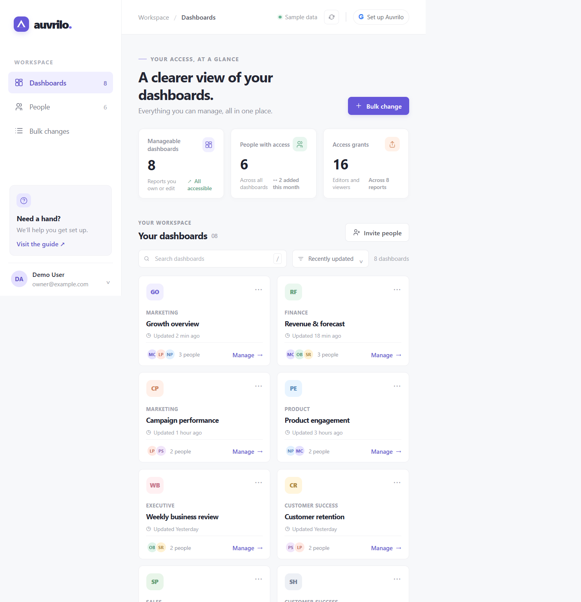
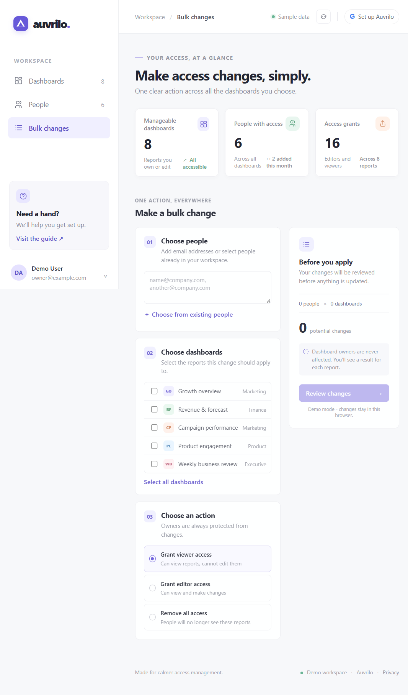

# Auvrilo

Auvrilo is an open-source access-management workspace for Looker Studio, designed to make sharing permissions easier to understand and update.

> **Current stage:** OAuth, encrypted storage, report and permission reads, and access mutation endpoints are implemented. A personal Gmail account has successfully signed in and loaded live reports in a real test installation. Automated tests mock Google responses; before production, verify grant, role-change, and revoke operations with a test report. Demo data remains the fallback when no live connection is available.

## Screenshots

Screenshots use fictional demo data. The reusable share image is [social-preview.svg](./static/images/social-preview.svg).

## Run locally

Requires Python 3.10 or newer.

1. Create and activate a Python 3.10+ virtual environment.
2. Install dependencies: `pip install -r requirements.txt`
3. Run `flask --app app setup-code`. This creates private session/encryption keys under the Git-ignored `instance/` folder and prints the one-time setup code. Keep the key file backed up and private.
4. Start Auvrilo with `flask --app app run --debug`, then open `http://localhost:5000/setup`.
5. Enter the setup code, the installation's Google OAuth client ID and secret, and the installation admin email. Register the callback URI shown in the wizard on that Web OAuth client. The OAuth client secret is encrypted in the database.

No `.env` file is needed for a local install. For hosted deployments, use the platform's private secret store or environment overrides for server keys and URL/security settings. See [.env.example](./.env.example) for optional overrides.

After identity sign-in, each user adds a separate Google OAuth web client for Data Studio access in their account settings. Register the displayed `/auth/data/callback` URI on that client and enable the Data Studio API. The first pass uses the installation's client for identity; the second uses the user's client and verifies that both passes use the same Google account.

**Google API authorization:** Google's [Data Studio API guidance](https://developers.google.com/data-studio/integrate/api) describes Workspace or Cloud Identity authorization and domain-wide delegation. Auvrilo also supports personal Gmail, which has successfully loaded live reports in testing. Access can still vary by OAuth client, account, project, and report. Some Workspace organizations require an administrator to authorize the OAuth client and scopes (`openid`, `https://www.googleapis.com/auth/userinfo.profile`, and `https://www.googleapis.com/auth/datastudio`). See the [permissions API reference](https://developers.google.com/data-studio/integrate/api/reference). Auvrilo limits discovery to 200 reports per sync and each write request to 500 user-report pairs.

## Security configuration

- OAuth client secrets and Google tokens are encrypted using AES-256-GCM with keys derived from `AUVRILO_ENCRYPTION_KEY`. The database stores ciphertext, not plaintext.
- The browser receives only a random opaque session cookie. Session contents, OAuth state, and tokens remain server-side. Cookies are HttpOnly and SameSite=Lax; set `AUVRILO_COOKIE_SECURE=true` when serving over HTTPS.
- Report data and permission details are cached in IndexedDB per signed-in account and cleared at sign-out. Users can forget OAuth credentials or delete their local Auvrilo account data.
- Set `AUVRILO_PUBLIC_BASE_URL` to the canonical HTTPS origin in production, `AUVRILO_TRUSTED_HOSTS` to the allowed hostnames, and `AUVRILO_ENV=production`. Production startup requires HTTPS cookies and trusted hosts.
- By default, session and encryption keys are generated once in `instance/keys.json`, separate from SQLite and excluded from Git. On Unix-like systems the file is owner-readable only; on Windows it inherits the parent folder's ACL, so keep that folder private. Protect and back up the key file with the database. If encrypted OAuth data exists and the file is missing, Auvrilo fails closed instead of generating a replacement key. Restore the backup; a new key cannot decrypt old data. Environment overrides such as `AUVRILO_SECRET_KEY` and `AUVRILO_ENCRYPTION_KEY` are available for hosted secret managers.
- The first-run code is derived from the session key and printed only when you run `flask --app app setup-code`. `AUVRILO_SETUP_KEY` can optionally override it; remove that override after setup and treat the code as private.
- The installation OAuth client secret is entered in the setup page and stored encrypted in SQLite. Per-user OAuth clients are entered in account settings and encrypted the same way. Never commit `.env` or share secrets.
- SQLite is suitable for local development and a single persistent host. Use a persistent disk for the database; ephemeral hosting filesystems will lose sessions and credentials on restart.

## GitHub and release notes

This repository is source code for a Flask application, not a GitHub Pages site. The GitHub Actions workflow runs the test suite on Python 3.10-3.13 and checks the browser scripts. A publicly hosted instance would still need a separate Python host, HTTPS, persistent SQLite storage, and Google OAuth configuration. Workspace organizations may require administrator authorization for the client and scopes.

The privacy page is a starting point for each self-hosted installation. The operator should review it, set the installation admin email in the setup page, and provide any privacy-policy or OAuth verification details required for their Google consent screen.

## Tests

Run `python -m unittest discover -s tests`.

## Project layout

- `app.py` - Flask app factory and OAuth routes.
- `database.py` - SQLite schema and account storage.
- `crypto_store.py` - authenticated encryption for OAuth material.
- `key_store.py` - private local key generation and persistence for env-free self-hosting.
- `google_tokens.py` - server-side token refresh and encrypted token updates.
- `lookerstudio_api.py` - report discovery, permission reads, and access mutations.
- `server_sessions.py` - opaque, server-side sessions.
- `templates/` - dashboard, credential setup, and sign-in status pages.
- `static/` - responsive styles and browser-side demo interactions.
- `tests/` - auth, CSRF, session, and encryption checks.

## License

MIT. See [LICENSE](LICENSE).
